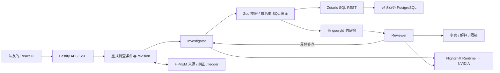

# 后端架构与边界

## 模块责任

`packages/contracts` 统一分析规格、API 状态、事实、证据、事件和 TS 客户端。`analytics` 处理确定性数据语义；模型只能提出 schema 内的指标、维度和筛选，不能提交任意 SQL。数据先分别汇总，再按用户/渠道/日期合并。

`agents/engine` 编排两种独立模型角色。语言提取合并显式 ContextPatch，基线查询后由 Investigator 起草、Reviewer 审核；Reviewer 的补查请求在原始用户范围内执行。每轮最多三次调查、八个底层 SQL 查询，重复规格不会重复执行。简单查询可在基线完成后直接返回。

最终事实数值取自实际结果。后端根据同一证据的前后数值生成 Observation，包括差额、变化率和费用/收入的同向或背离比较。Investigator 选择 Observation ID、解释重点和补查请求；Reviewer 核查这些证据是否足以回应当前问题。最终数字与比较句直接引用所选 Observation，不由模型重新计算或改写。未知 ID 会被拒绝。limited 只保留可核对事实，不发布未审查通过的推断。

模型负责调查路径与证据选择，因此可以根据追问改变查询；确定性报告层负责事实一致性。当前解释以可复核的观测变化和结构贡献为主，不证明广告因果增量。

`context` 的显式条件是本轮权威状态。每次有效变更增加 revision，清除旧证据引用并重新查询。模型主动补查不得扩大用户明确的筛选。非法粒度变更不会覆盖之前有效条件。

`memory` 使用实际 H-MEM 参考实现的 add/query/feedback 与 ledger，保存用户明确要求的默认窗口及带 run/evidence 来源的摘要。只召回当前会话、当前数据版本、未被替代或标错的规范默认键。普通临时筛选留在 Context。hash embedding 不是可靠中文语义检索，应用使用规范键和 scope 再次过滤。

## 运行与故障

- 本地 JSON 状态原子替换；服务重启将未完成 Run 标记为 failed 并保留证据，避免永远 running。
- 同一会话串行，最多两个会话同时运行；单进程 MVP，不部署多副本共享目录。
- 整轮六分钟上限，意图请求三十秒、调查/审查请求九十秒，SQL 九十秒；网络/服务暂时失败最多一次重试，认证失败不重试，JSON 校验一次修复。
- 取消使用 AbortSignal；可中止等待中的 HTTP 请求，但不保证远端供应商停止已经接收的计算或计费。
- Live 只用 Zetaris，失败不会偷偷回退 fixture。fixture 仅用于开发、测试和明确标注的示例回放。
- 服务默认只绑定 loopback；没有实现互联网用户认证。凭据只在服务器环境与本机 `.env.local`，不发给浏览器、不写入查询证据。

## 原始来源

导入保留原始 user ID、访问行号与购买导入 ID。profile 为首次观测归属，purchase_facts 为快照内购买序号；这些派生表独立于 Zetaris 系统数据库。实际查询 ID 与完整 SQL 在 Evidence 内，可以沿 manifest 固定哈希重现，生成的 ID 不冒充平台订单号。
