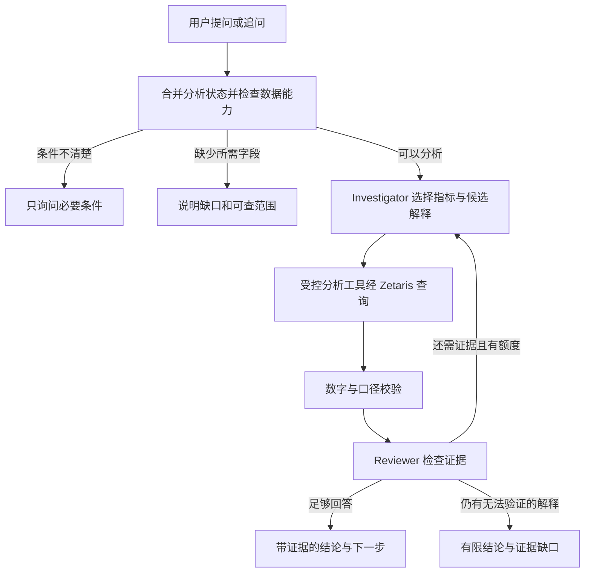

# 营销增长调查 Agent MVP 实施计划

日期：2026-10-23。产品暂名 StoreWhy，首个 Demo 对象为 Procrastinate Pro+ 付费 App 教学案例。

定位已经确认：帮助增长运营人员围绕渠道费用、访问、获客、付费和复购自由提问，通过多轮查询和独立审查形成有证据的解释。一个完整调查案例用于展示，产品支持一类问题及其追问。

本轮只编写计划。阶段 0 的文档核查已完成；阶段 1—7 均未实施。执行时按编号推进，每阶段通过验收后记录证据；“开始下一步”指进入当前未完成阶段。开发由主会话推进，产品内的两个 Agent 是应用组件。

## 1 产品目标和完成标准

目标用户：需要理解渠道费用与用户收入变化的增长运营人员。

用户获得的结果：结论、关键数字、可追溯证据、已检查的其他解释，以及下一步应核查的事项。结论可以是“当前证据不足以区分这些解释”。

MVP 完成标准：

- 支持下表六类问题中的开放措辞，以及不同日期、渠道和人群组合。
- 同一调查中可以继续拆分、筛选、切换观察窗口、纠正条件、开始新话题。
- Why 调查根据数据和 Reviewer 的反馈选择后续查询；有可验证的返工路径。
- 数字来自真实执行的查询；每个结论可以展开证据和统计口径。
- 越界问题有明确的数据缺口说明；不会虚构广告曝光、点击、素材、利润或因果增量。
- Zetaris 实际承担在线分析查询；Nightshift 承担模型调用；H-MEM 工作在真实功能中并有测试。

## 2 MVP 的问题范围

| 问题族 | 示例 | 首版能力 |
| --- | --- | --- |
| 现状查询 | 7 月各渠道花了多少费用、获得多少首次出现用户？ | 金额、访问、用户、购买记录和购买用户汇总；日、周、月趋势 |
| 时期变化 | 为什么 7 月费用增加，新用户收入却几乎没涨？ | 自然时期比较，或等长用户观察期比较；检查渠道结构与相关指标变化 |
| 结构贡献 | 哪些渠道贡献了收入增量？增长来自首次购买还是后续购买？ | 渠道金额增量、首次与后续购买收入拆分 |
| 用户批次 | 这批用户多久首次购买？首访后 7 天和 14 天表现如何？ | 首次购买延迟、观察期付费比例、每用户收入和复购表现 |
| 人群比较 | iPhone 和 Android 用户的付费表现有什么不同？ | 按首次观测设备、国家或渠道比较用户行为与收入；最多两个拆分维度 |
| 解释检验 | 新渠道真的更差吗，还是观察时间不足？ | 检查批次成熟度、分母、比较口径、渠道占比；按反馈重查 |

首版明确边界：

- 一个业务、一组有版本的三表快照；时间取数据实际覆盖的 2019 年区间。
- 语言先支持中文提问和界面，保留英文数据字段与渠道名；提交材料提供英文简介。
- 归属规则仅支持“首次观测访问”的渠道、设备和国家。订单没有 session ID，这些归属不是购买瞬间的设备或广告触点。其他归因模型暂不支持。
- 用户观察窗口支持 7 天、14 天，默认 14 天。自然月收入与用户批次收入是不同指标。
- 费用只有“渠道 × 日期”粒度。可以按设备或国家分析用户与收入，不能直接计算该设备或国家的广告费用、CAC、ROAS。
- 不支持 CTR、CPC、广告素材疲劳、商品或结账步骤分析、退款、利润、预算最优分配及广告因果增量。
- 不支持任意新数据上传、任意 SQL、真实广告账户连接和修改广告预算。

缺少时间时优先继承当前调查；新对话显示并使用默认的“2019 年 7 月对比 6 月”。“今天、今年、上个月”若指向样例范围之外，询问用户要分析的数据时期，不暗中把 2026 年替换成 2019 年。

## 3 数据和指标契约

### 3.1 原始数据与版本

| 原始文件 | 核验行数 | 字段 |
| --- | ---: | --- |
| visits_info_short.csv | 309,901 | User Id, Region, Device, Channel, Session Start, Session End |
| orders_info_short.csv | 40,212 | User Id, Event Dt, Revenue |
| costs_info_short.csv | 1,800 | dt, Channel, costs |

来源分别为 `https://code.s3.yandex.net/datasets/` 下的同名文件。下载时记录 URL、时间、SHA-256、行数、字段和覆盖区间，内容版本由三文件哈希共同决定。已有哈希在 [数据画像](../../research/data-audit/basic-profiles.json)。

新用户首次观测及费用覆盖 2019-05-01 至 2019-10-27，访问和购买观察到 2019-10-31。后四天属于已有用户的后续观察。CSV 未注明币种或时区：沿用样例金额单位与原始时间，不添加人民币、美元符号或地区时区换算。

三表来自同一公开教学案例，界面和 README 如实标明。数据原始业务真实性与再分发许可尚未独立确认；公开仓库先保留来源、校验清单与本地导入说明，不打包原始 CSV。免凭据示例使用同字段的自制小样例，并与公开数据模式明确区分。

### 3.2 计算规则

- user ID 按字符串保存；金额以 Decimal 或整数最小金额单位计算，显示时统一四舍五入。
- “新用户”指本快照中首次出现的用户，不宣称是业务历史上的首次注册。
- 先为每个用户确定首次观测访问及其归属；同一时间有多个候选来源时记录冲突，采用稳定且公开的规则，不依赖文件偶然顺序。
- 购买记录每行是一个观测购买事件。原表没有 order ID；生成的导入行 ID 仅用于证据定位，不冒充原始业务订单号。
- H 天观察区间为 `[首次观测访问时间, 首次观测访问时间 + H × 24 小时)`。
- 付费比例 = H 天内购买用户数 / 该批首次出现用户数。
- H 天每用户收入 = H 天收入 / 该批首次出现用户数。
- H 天复购比例 = H 天内至少购买两次的用户数 / H 天内至少购买一次的用户数。
- 首次购买延迟只对已观测到首次购买的用户计算；未购买用户保留在转化分母中。
- 自然时期收入按购买时间分组；用户批次收入按首次观测日期分组。界面和证据必须区分。
- 费用先按渠道、日期汇总；购买先按用户/批次汇总，再关联。禁止直接把费用明细、多个访问和多笔购买相乘关联。
- 费用与批次收入比较时，匹配批次获客日期及渠道，明确这是观测归属下的比较，不是实验增量或利润。
- organic 没有提供费用；缺失费用不自动补零，不计算除以零的回报率。
- 每种指标声明允许的日期模式、筛选和分组粒度。设备或国家筛选不得把完整渠道费用当作该子人群费用。
- 观察期比较仅包含具有完整 H 天随访的获客日期；同时裁剪匹配费用日期并披露排除人数。不能只裁收入而保留全部费用。自然月天数可以不同，但需展示天数，必要时补充日均对照。
- 零分母返回“不可计算”。“收入/广告费用”使用完整名称，不称为利润 ROI。

变化调查可使用同一批次、同一窗口下的恒等关系：`收入 = 用户数 × 付费比例 × 每位付费用户收入`。渠道金额增量可以相加；乘法因素之间的交互不随意分摊成“原因贡献百分比”。

### 3.3 独立参考值

已有核算采用首次观测为付费渠道的用户、完整 14 天窗口：

| 指标 | 2019-06 | 2019-07 |
| --- | ---: | ---: |
| 记录广告费用 | 15,090.05 | 16,447.06 |
| 付费渠道首次观测用户 | 15,315 | 14,941 |
| 这批用户 14 天收入 | 13,645.59 | 13,688.12 |

这些值作为独立核对基准，不写进产品答案逻辑。来源和定义见 [月度核算](../../research/data-audit/spend-revenue-monthly-check.json)。其他时期和追问必须重新计算。

## 4 Agent 的动态调查

### 4.1 两个 Agent 与一个执行工具层

| 组件 | 责任 | 输出 |
| --- | --- | --- |
| Investigator Agent | 理解问题、合并追问条件、提出候选解释、选择查询、根据证据追加调查、撰写报告 | 结构化意图、假设、工具请求、引用证据的回答 |
| Reviewer Agent | 独立检查口径与证据充分性，指出遗漏的解释或无依据的断言，决定是否需要重查 | ready / needs_query / missing_data / clarify 及具体理由 |
| 分析执行工具层 | 校验请求，编译并执行受控分析查询，计算派生指标，返回可追溯结果 | 数值、范围、查询 ID、来源与校验结果；它是工具，不包装成第三个 Agent |

两个 Agent 可以复用同一个模型，但使用独立提示词和结构化输出契约。确定性的指标校验始终执行，不能被 Reviewer 的自然语言通过意见覆盖。



### 4.2 可复用分析工具

以下为本项目拟新增的内部接口，不是 Zetaris 或 Meterless 已有的 API：

- `get_data_catalog()`：字段、覆盖区间、指标定义、可用维度、缺失能力与数据版本。
- `query_metrics(AnalysisSpec)`：目标指标、日期模式、时期/批次、H、筛选、分组；返回表格与证据。
- `compare_periods(AnalysisSpec)`：两时期数值、差额、相对变化、天数及用户覆盖情况。
- `inspect_contributions(AnalysisSpec)`：渠道增量、首次/后续购买收入构成，支持按数据结果选择下钻。
- `get_evidence(evidenceId)`：对应 SQL、来源、统计定义、实际范围、有限行样例和结果校验。分组结果若被行数限制截断，标明覆盖不足并继续分页/缩小范围，不能用局部结果解释整体。

Investigator 输出严格 JSON 的工具指令，由 Zod schema 校验；通过白名单指标与维度编译 SQL。模型不直接提交任意 SQL。优先采用普通 chat completion 内容承载 JSON，不预先依赖尚未验证的原生 tool calling 或 response_format 参数。

### 4.3 选择分支与停止条件

- 简单指标查询：一次查询和必要校验即可回答。
- Why：先获得基线，再根据结果检查渠道结构、单位用户费用、付费比例、每付费用户收入、复购或观察期。不是每次机械执行全部分支。
- Reviewer 可请求新的拆分、口径修正或补充解释；只有发现具体缺口才返工。
- 输出区分“核实的变化”“证据支持的解释”“尚未验证的解释”。相关变化不写成已证明的广告因果作用。
- Why 至少经过一次独立 Reviewer；数字引用必须存在于证据中。只有核对通过的数字可以进入最终结构化事实。
- 单轮用户请求最多 3 个调查回合、8 个分析查询；JSON 格式修复最多 1 次。超过预算输出已核实部分和未完成项。
- 同一请求避免重复执行相同的“数据版本 + 指标契约版本 + 分析规格”。模型请求超时上限采用已验证的 180 秒，同时受整轮 6 分钟总上限约束；认证失败不重试，暂时性网络错误最多重试 1 次。
- 无数据、零分母、查询错误、模型不可用分别作为显式状态。Live 模式不偷偷改用本地计算或缓存答案冒充成功。

## 5 追问与记忆

### 5.1 分析状态

后端持久化 `InvestigationContext`，包含：conversationId、investigationId、数据版本、指标契约版本、revision、目标指标、日期模式、基准与目标时期、筛选、分组、观察窗口、归属规则、证据 ID、开放假设和当前状态。

解析追问时先生成 `ContextPatch`，只修改用户明确改变的字段。状态规则：

| 用户输入 | 状态变化 |
| --- | --- |
| 按渠道拆开看 | 保留时期、指标、筛选和 H，修改分组 |
| 只看 FaceBoom | 保留其他条件，新增/替换渠道筛选 |
| 改成首访后 7 天 | H 从 14 改为 7，重算相关指标 |
| 我说的是 8 月，不是 7 月 | 更新时期，增加 revision，旧证据不进入新结论 |
| 去掉设备限制 | 清除指定筛选，不清空其他条件 |
| 开始一个新分析 | 创建新的 investigationId，不继承旧任务临时筛选 |
| 这个渠道呢 | 如果指代不唯一，询问渠道；不猜测 |
| 只看 iPhone（此前在看费用回报） | 先解释设备成本缺失，提供用户/付费/收入分析范围；不沿用全渠道费用计算设备回报 |

当前用户明确指令优先于当前状态，当前状态优先于记忆中的默认偏好。时间、筛选、H 或指标改变后重新查询；缓存只能使用完全一致的数据版本和分析规格。数据版本或任务不一致的旧数字不能作为新证据。

页面持续显示当前分析范围。每次追问用简短文字说明改变了什么，避免用户在不知情时切换统计口径。

### 5.2 H-MEM 的实际功能

第一版只启用一个 Meterless Engine：H-MEM。

- 保存用户明确设定的默认观察窗口、确认过的指标解释、用户纠正和已审查的调查摘要。
- 每条记录有 source、provenance、confidence、conversation/data scope；调查摘要附 evidenceId 和数据版本。
- 显式当前状态负责精确延续条件；H-MEM 负责可追溯的保存、检索、重新注入、纠正和反馈。
- 每个数据版本及会话使用隔离存储；任务摘要再按 investigationId 隔离。跨任务仅允许读取用户明确设为默认的规则。
- 改正旧规则时写 replacement/supersedes，并将旧记录标为 superseded；应用注入层排除已替代的规则，保留审计历史。
- `wrong` 反馈会影响检索并记录 ledger；未验证的模型解释不自动晋升为长期事实。
- 参考实现的 embedding 是确定性 hash，不宣称具备生产级中文语义检索。MVP 通过规范化指标键、窗口键与英文 tags 检索，再核对 typed 值及 scope。
- 重启应用后能恢复已保存的规则，并显示其来源。未设置为默认的“只看某渠道”等临时筛选不会污染新调查。
- Dreaming、Sleep 与其他三种 Engine 不进入首版用户流程。

## 6 Zetaris 与 Meterless 的具体分工

| 部分 | 具体工作 | 验收证据 |
| --- | --- | --- |
| 数据准备层 | 下载和校验三表、规范字段与类型、生成稳定导入行 ID；原始业务记录保持可追溯 | 哈希、行数、孤立买家检查、数据覆盖清单 |
| Zetaris | 登记三类业务记录，执行筛选、关联、聚合及用户批次相关查询，形成结果来源 | 实际 SQL、queryId、结果、耗时；与独立基准一致 |
| Nightshift | 两个 Agent 的统一模型入口，使用 Runtime token；记录实际模型和 provider | /models 探测、真实调用与 meterless winning_route/receipt |
| NVIDIA Nemotron | 经 Nightshift 执行问题理解、计划、审查和解释 | 请求 trace 中的实际 provider/model；不依赖网页当前打开的模型 |
| H-MEM | 保存、检索和纠正有来源的口径与记忆，供后续请求使用 | add/query/feedback、supersedes、ledger、重启恢复测试 |
| 应用工具层 | 指标契约、范围验证、SQL 编译、数值校验、会话状态和输出证据 | 指标与追问测试；数值引用完整性 |

首选技术栈：Node.js 22 + TypeScript 后端、React + Vite 前端，使用同一语言接入 H-MEM TypeScript 参考模块。HTTP/输入校验优先使用 Fastify/Zod，开发运行采用 tsx；依赖在实施时锁定版本，并验证 H-MEM 的 .ts 导入在最终构建中可运行。已有 Python 环境保留，用于独立参考核算与现有 setup 检查。

首选数据通路：三表进入专用 PostgreSQL 16 数据服务，经 Zetaris 的 JDBC datasource 登记后，由应用调用 Zetaris REST SQL 接口分析。它与官方 Zetaris 自身的元数据库隔离，保留现有服务与端口。

JDBC 登记是有文档、尚未在本机验证的接入点。阶段 1 先做连通性验证；若该驱动/元数据导入无法工作，尝试已验证的 REST table 路径，用规范 JSON feed 暴露同一数据快照。备选也必须核对完整行数和分析结果。两个路径都未通过时，阶段 1 未完成，不绕过 Zetaris 宣称完成。

## 7 阶段 0 文档核查与 Allowed APIs

本阶段已完成阅读和路径核对，已有的成功记录不等于新数据接入成功。

| 编号 | 已阅读来源 | 可使用的真实接口或模式 |
| --- | --- | --- |
| Z1 | [zetaris_sql.py](../../setup/references/zetaris-getting-started/scripts/zetaris_sql.py)，RestChannel，约第 198—240 行 | GET /datasource/datasources；POST /sql-editor/sqls/run，body 为 queryId/sql/source/limit；Bearer、X-Org-ID、X-Request-ID |
| Z2 | [Lightning commands](../../setup/references/zetaris-getting-started/docs/guides/zetaris-lightning-sql-commands.md)，4.1—4.3 | CREATE DATASOURCE ... OPTIONS(jdbcdriver,jdbcurl,username,password,fetchsize)；REGISTER DATASOURCE TABLE(S) |
| Z3 | 同一文档 6.1—6.2，以及 [PokéAPI 模式](../../setup/references/zetaris-getting-started/open_data/rest_apis/sql/non_rate_limited/02_pokeapi_create.sql) | CREATE REST SESSION TABLE；CREATE LIGHTNING REST TABLE；可达 HTTP JSON 来源 |
| Z4 | [recipe readiness](../../setup/references/zetaris-getting-started/docs/guides/recipe-readiness.md)、[文件 cookbook](../../setup/references/zetaris-getting-started/open_data/parquet_csv/HOWTO.md) | 本地 CSV 缓存不能直接当作已登记的 Zetaris 文件表；SQL 数据库 cookbook 尚未形成已验证 onboarding 路径 |
| N1 | [provider contract](../../setup/references/meterless/docs/agent-ready/add-meterless-provider.md) | OpenAI-compatible /v1/models、/v1/chat/completions；Bearer、meterless-app、meterless-scope；401/403 与 offline 区分 |
| N2 | [本机检查器](../../setup/check_environment.py)，check_meterless，约第 118—158 行；[已保存结果](../../setup/status.json) | 本机现有 Runtime 已成功使用具体 nvidia 模型 ID；读取 winning_route；严格 JSON/原生 tool calling 尚未验证 |
| H1 | [H-MEM spec](../../setup/references/meterless/engines/hmem/AGENTS.md)、[reference README](../../setup/references/meterless/engines/hmem/reference/README.md) | 分层记忆、来源、审计与纠正契约；参考模块不是已发布生产 SDK |
| H2 | [index.ts](../../setup/references/meterless/engines/hmem/reference/src/index.ts)、types.ts、memoryStore.ts、memoryRetrieval.ts | new HMEM({persistDir,clock,actor})；add(input)、query(query,{topN,threshold,chatId})、feedback(id,kind)；store.update 支持显式替换标记 |
| H3 | reference/test/smoke.test.ts | 参考测试包含来源拒绝、排名公式、feedback、superseded、ledger、确定性等；参考测试通过不能替代本产品集成测试 |

参考版本：Zetaris 文档 `6a2fbaa47c32c9ac33f6584c64b43b146c621bed`；Meterless `1742dec56a66e58eef9dda2d2b865823758ca8cd`。复制 H-MEM 参考模块时保留 Apache-2.0 许可与来源，并说明本项目修改。

当前基础证据：[setup/status.json](../../setup/status.json) 记录 13 项通过，已有 Zetaris SELECT 1 和 Nightshift→NVIDIA 调用。Node 本次检测为 v22.22.0。项目目前没有 Git 仓库。产品调查循环、数据接入、UI 与 H-MEM 集成尚未实现。

## 8 顺序实施计划

### 阶段 1 数据与模型通路验证

预计 2—3 个专注小时。依赖：阶段 0。

工作：

- [ ] 初始化本地 Git main，收录计划与已有 setup 研究记录；先完善忽略规则，排除原始下载、.state、凭据、平台包和参考依赖。创建实施分支。
- [ ] 建立最小 TypeScript workspace 与开发/测试命令；锁依赖版本。
- [ ] 从已核验来源重现下载及哈希检查，生成 manifest；保留三类原始业务数据独立性。
- [ ] 首选用专用 PostgreSQL 加载三表，经 Z2 登记；先用小片段检查 schema，再核对全量。
- [ ] 将本项目的 Zetaris 客户端按 Z1 的请求契约实现，保留 queryId 和结果来源。
- [ ] 按 N1/N2 通过 Nightshift 执行 3 种结构化意图试验；验证 JSON 校验和一次修复路径，记录模型/provider。先沿用当前已验证、由环境变量指定的 nvidia 模型。

文档与复制模式：Z1—Z4、N1—N2；数据字段以第 3 节与 research/data-audit 为准。

完成定义：三表通过 Zetaris 返回 309,901 / 40,212 / 1,800 行，购买用户全部能关联访问；通过 Zetaris 算出广告费用月汇总；Nightshift 返回可校验指令，错误 token 显示 unauthorized。保存 evidence/phase-1 的脱敏请求和结果。

防错：UI 可打开不算数据接入完成；模型文本成功不算 JSON 契约通过；JDBC 文档示例不当作本机验证；数据查询不能绕过 Zetaris。若备选 REST 路径使用切片，必须重新声明覆盖范围，不冒充完整快照。

### 阶段 2 指标语义层和查询工具

预计 3—4 小时。依赖：阶段 1。

工作：

- [ ] 实现字段目录、AnalysisSpec schema、指标/粒度能力矩阵与只读 SQL 编译。
- [ ] 实现日期汇总、首次观测用户、首次/后续购买、7/14 天付费与收入、渠道费用匹配。
- [ ] 实现贡献比较与 evidenceId、spec fingerprint、数据版本和统计口径。
- [ ] 用现有 Python 路径建立独立参考核算；先冻结数值与边界用例，再接入 Agent。
- [ ] 在小型自制 fixture 中覆盖多渠道用户、多次访问、多次购买、零购买、缺失费用、末期未成熟用户。

文档与复制模式：Z1 的查询调用、Z2/Z3 的查询对象；业务计算遵循第 3 节，不从模型提示词推导口径。

完成定义：6/7 月参考值一致；金额误差不超过 0.01 样例单位、人数完全一致；整批未成熟处理、连接放大、零分母、设备成本越界均有可复现测试。保存实际 Zetaris SQL 与参考核对差异。

防错：费用不随订单行数放大；不把购买记录数当作购买用户数；不混自然月与获客批次；不把记录金额解释为利润或美元。

### 阶段 3 Investigator 与 Reviewer 调查循环

预计 4—5 小时。依赖：阶段 2。

工作：

- [ ] 定义两个 Agent 的提示词、JSON 输出契约和共享证据状态；走 Nightshift。
- [ ] 实现简答、调查、待澄清、能力不足、有限结论、失败六类路径。
- [ ] 依据数据结果选择查询和假设；Reviewer 给出具体补查要求，Investigator 接受反馈重查。
- [ ] 实现数值引用检查、范围检查、轮数/查询/时间预算及错误恢复。
- [ ] 将报告拆成事实、解释、限制与下一步；数字绑定 evidenceId，禁止无来源数值进入最终事实卡。

文档与复制模式：N1/N2；内部工具接口采用第 4 节；Z1 负责真实查询。

完成定义：运行主调查及至少两个不同问题，日志展示真实不同的分析规格；至少一例因 Reviewer 指出的具体缺口发生追加查询或结论修改；一次简单查询能直接结束；没有证据的因果断言被拒绝或改写。越界问题和服务异常不会生成伪造答案。

防错：不写根据特定提问文本返回固定答案的分支；不强制每题完整跑相同查询序列；不把程序函数命名成虚构 Agent；不将参考数据硬编码到回答。

### 阶段 4 追问状态与 H-MEM 集成

预计 3—4 小时。依赖：阶段 3。

工作：

- [ ] 实现 InvestigationContext、ContextPatch、revision 和状态持久化；会话内串行提交变更。
- [ ] 实现第 5 节的继承、替换、清除、重置及必要澄清。
- [ ] 按 H1—H3 复制并注明 H-MEM 参考模块，接入 add/query/feedback、provenance、ledger 与显式 supersedes。
- [ ] 提供“记为本会话默认口径”操作；普通筛选只保存在当前调查。
- [ ] 参考检索结果再次核验 scope 和状态，采用规范指标键；对记录进行错误反馈和替代后不继续注入旧规则。
- [ ] 持久化写入使用原子替换；重启恢复和新会话隔离可测试。

完成定义：三组各至少四轮对话可正确继承与重算；14 天改为 7 天后 query spec 和结果均变化；纠正月份不会继续引用旧数字；新分析清除临时筛选；重启后恢复来源明确的默认窗口；其他会话/数据版本不会串入。产品集成测试通过，不能只提交上游 10 个参考测试。

防错：不能把 prompt 中粘贴历史聊天称为 H-MEM 集成；不能用 hash embedding 声称可靠中文语义搜索；不能让旧记忆覆盖本轮明确指令。

### 阶段 5 可操作的调查界面

预计 3—4 小时。依赖：阶段 3—4。

工作：

- [ ] 一个主页面：数据范围与连接状态、自由输入及追问、当前分析条件、结果与证据抽屉。
- [ ] 展示简短调查事件：正在比较、正在拆分、发现口径问题、重新查询、已得到有限结论。
- [ ] 支持修改当前时期/渠道/7 或 14 天，发出与自然语言相同的 ContextPatch。
- [ ] 最多一张趋势/对比图与一张结果表；证据抽屉可看查询、字段和源记录定位。
- [ ] 实现加载、澄清、无数据、能力不足、模型/数据服务异常和取消状态。
- [ ] 做最小免凭据示例回放，使用自制 fixture 和已标注的示例 trace；发起新的开放式调查需要 Live 连接，回放不显示为在线 Agent。

文档与复制模式：组件按第 4—5 节的状态和事件契约展示；供应商连接状态遵循 N1 的 online/unauthorized/offline 区分。

完成定义：浏览器实际打开目标 route，完成主调查与三轮追问；条件变化可见，证据可展开，返回不误用旧结果；服务关闭后有真实错误状态；示例与 Live 清楚标注。保存页面截图和检查步骤。

防错：不堆 BI 大屏、复杂动画、多页面后台、用户系统或完整 i18n；不在产品主流程展示与用户决策无关的实现细节。

### 阶段 6 完整验证与泛化验收

预计 3—4 小时。依赖：阶段 1—5。

工作：

- [ ] 建立 12 个固定基准案例，覆盖六类问题与缺失字段、零分母、范围外日期、批次不成熟等边界；预期口径与关键数值独立定义。
- [ ] 再保留 10 条不写进系统提示词、路由或示例的改写/组合提问，验证日期、渠道和问题组合的泛化。
- [ ] 验证三组多轮追问、记忆纠正与持久化、服务失败和一次 JSON 修复。
- [ ] 完成 tests、lint、typecheck、build、真实 Zetaris 集成检查与浏览器检查。
- [ ] 记录模型/provider、查询耗时、总耗时、轮数、通过/失败项，不反复扩大测试范围来拖延收尾。
- [ ] 只有新失败、修复或未解决疑点才重跑相关检查；供应商服务缺失应记录为未完成的 Live 检查，不能当作通过。

完成定义：固定数字/口径与边界检查全部通过；10 条泛化问题至少 9 条正确处理，并公开记录剩余失败的边界。凡数字错误、跨会话污染、越界伪造字段、费用错误分摊或绕过 Zetaris，均为阻断项，不能用总体通过率抵消。

性能：记录热启动的简单查询与 Why 调查耗时；目标分别约 20 秒与 90 秒内，外部模型延迟需如实报告。超时可控且页面有进度，不能无期限循环。

文档核验：实现接口逐一对应 Z1—Z4、N1—N2、H1—H3；任何新增供应商 API 先读实际文档再使用。

### 阶段 7 Review 本地合并与提交材料

预计 2—3 小时，另留录制与提交缓冲。依赖：阶段 6。

工作：

- [ ] 单独做 correctness review：金额/分母、成熟窗口、费用粒度、记忆隔离、错误状态、模型与数据 trace。
- [ ] 修复阻断项并重跑受影响验证；主会话给出审查结论与残余限制。
- [ ] 验证通过后本地 merge 到 main；不 push、不创建远程仓库、不对外提交，除非用户明确要求。
- [ ] README 写明依赖、三表来源、口径、配置、启动、离线 tests、Live 验证、示例回放和数据限制。
- [ ] 保留 H-MEM 许可与版本说明，明确既有 sponsor 参考代码和本项目新增工作；Zetaris/Engine/Nightshift/NVIDIA 的作用各有证据。
- [ ] 准备 1—4 分钟演示脚本：完整 Why 调查、真实追加查询、一轮条件修改、一个缺数据问题；准备简短 slides 内容。
- [ ] 最后核对公开仓库、视频、slides 与 sponsor 说明清单；发布、push、正式提交或对外打包在用户要求后执行。

完成定义：main 本地可重现，clean setup 按 README 成功，review 无阻断项；提交材料在本地可检查；所有未完成的服务或功能明确标注。

## 9 建议目录和命令

计划中的文件布局，不代表已经创建实现：

```text
apps/server/src/agents/       Investigator 与 Reviewer
apps/server/src/analytics/    指标契约 查询编译 校验
apps/server/src/integrations/ Zetaris Nightshift
apps/server/src/context/      会话状态和 ContextPatch
apps/server/src/memory/       H-MEM 适配与 scope
apps/web/                    单页调查界面
packages/contracts/          前后端共享的规格 证据 事件
packages/hmem/               保留来源许可的参考模块
infra/                       专用数据服务和登记配置
data/manifests/              原始数据哈希与覆盖信息
data/fixtures/               可再分发的自制同字段样例
scripts/                     下载 导入 独立核算 验证
tests/                       指标 边界 Agent 多轮 Live
.state/                      本地会话 记忆 运行证据 忽略提交
evidence/                    脱敏阶段证据和评测摘要
docs/plans/                  本计划和阶段完成记录
```

阶段 1 建立并记录统一命令，预期接口为：`npm run data:prepare`、`npm run data:register`、`npm run dev`、`npm test`、`npm run test:live`、`npm run lint`、`npm run typecheck`、`npm run build`、`npm run eval:live`。这些是拟新增项目命令，当前尚不可运行。Live 前重新执行现有 `setup/check_environment.py --live`。

## 10 时间安排与删减顺序

按 Toronto 当地日期安排，各阶段合计约 20—27 个专注小时，再留 3—4 小时录制与返工缓冲，不含供应商阻塞与等待：

| 日期 | 目标 |
| --- | --- |
| 10 月 23—24 日 | 完成阶段 1—3，尽早验证数据与结构化模型调用，得到真实调查循环 |
| 10 月 25 日 | 完成阶段 4—5，追问、H-MEM 与可操作界面贯通 |
| 10 月 26 日 | 阶段 6—7 的验证、review、README 和演示材料 |
| 10 月 27 日 | 缓冲、干净环境复现和提交准备；已提供材料中的截止时间为 23:45 UTC，即 Toronto 19:45 |

若时间不足，先删高级图表、额外页面、复杂记忆自动整理、其他 Engine、归因模型扩展和自动报告排版。保留自由提问、追问重算、数字和口径正确、实际 Zetaris 查询、独立审查、H-MEM 功能与测试、来源证据。

## 11 当前进度

- [x] 定位与数据范围已经确认。
- [x] 阶段 0：阅读实际 sponsor 文档和参考实现，核对基础证据。
- [ ] 阶段 1：数据与模型通路验证。
- [ ] 阶段 2：指标语义层和查询工具。
- [ ] 阶段 3：动态调查循环。
- [ ] 阶段 4：追问与 H-MEM。
- [ ] 阶段 5：调查界面。
- [ ] 阶段 6：完整验证。
- [ ] 阶段 7：review、本地合并及提交材料。

下一步：阶段 1。首先证明本项目的数据和结构化模型调用可以贯通，再推进后续实现。
