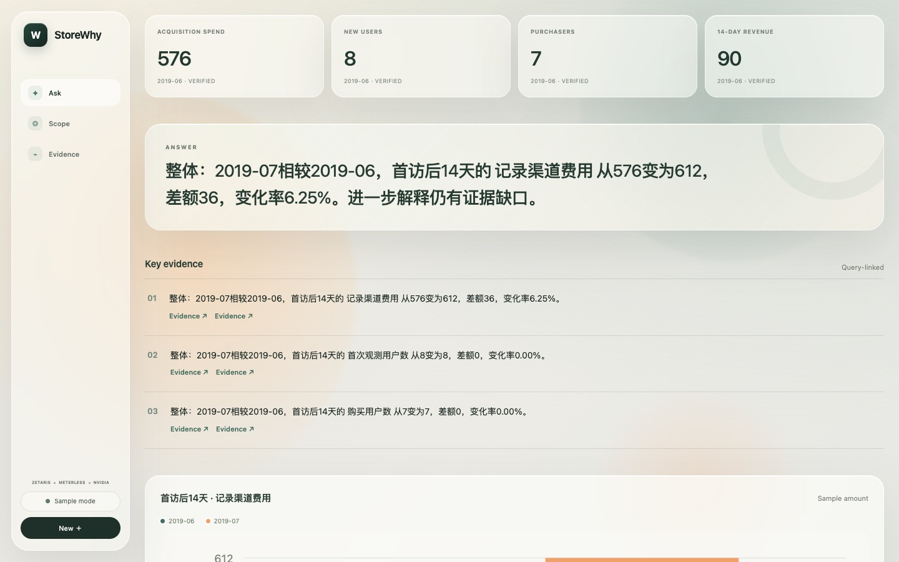
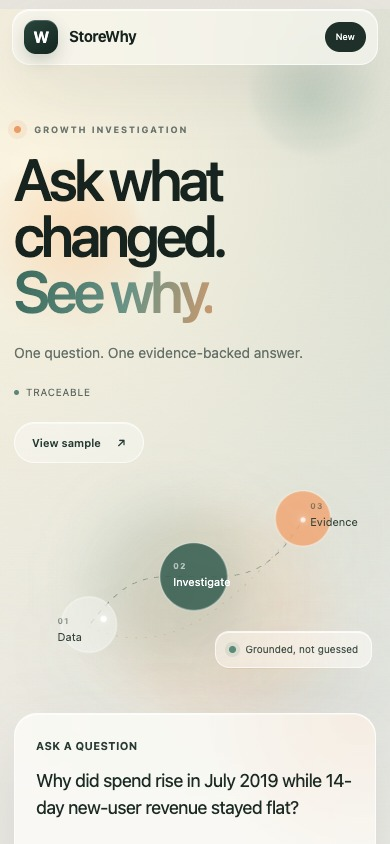

# StoreWhy UI Guide

StoreWhy turns a growth question into an evidence-backed investigation. The interface is intentionally minimal: ask one clear question, inspect the answer, and continue only where the evidence suggests a useful next step.



## Language support

StoreWhy accepts questions in either English or Chinese.

English example:

> Why did spend rise in July 2019 while 14-day new-user revenue stayed flat?

Chinese example:

> 为什么 2019 年 7 月广告费用上升，但新用户 14 天收入没有同步增长？

The user message stays in the language in which it was entered. The interface and generated output—including conclusions, evidence, chart labels, progress, follow-ups, and errors—are normalized to English so the shared demo remains consistent.

## Start the interface

Install dependencies once:

```sh
npm ci
```

### Sample mode

Start the fixture backend in the first terminal:

```sh
npm run dev
```

Start the UI in a second terminal:

```sh
npm run dev:ui
```

Open **http://127.0.0.1:5173/** and choose **Explore a sample investigation**. This replays a self-authored fixture and does not claim to be a live agent run.

### Live mode

After Zetaris, Nightshift, NVIDIA, and the local environment are configured:

```sh
npm run demo
```

The command starts the Live API and web app together. For first-time platform setup, see the [recording guide](recording.md).

## Investigation flow

1. **Ask.** Enter a business question in English or Chinese.
2. **Check the scope.** Confirm the period, observation window, audience, and channel shown beside the composer.
3. **Investigate.** Select **Investigate**. The progress state reflects the actual run; a failed Live request never falls back to an old answer.
4. **Read the conclusion.** The most direct finding is shown first, followed by the strongest supporting evidence.
5. **Inspect evidence.** Open an **Evidence** link to view the exact metric cell, query ID, SQL, definition, and coverage behind the claim.
6. **Continue.** Use a suggested follow-up or adjust the channel or 7/14-day window. Each action preserves an explicit, validated scope.
7. **Switch conversations.** Desktop shows the conversation rail. Mobile keeps a focused vertical layout and supports moving between conversations without compressing the investigation into a desktop-shaped screen.

## What the interface communicates

- **Sample** identifies a deterministic fixture replay.
- **Live** means the question ran through the configured data and model services.
- **Limited** means the measured change is available, but a fuller explanation still needs evidence.
- **Unsupported** means the required data does not exist in the dataset, such as impressions or clicks for CTR.
- Evidence-backed charts never turn missing values into zero and every rendered point links to a queried source cell.

## Responsive layouts

The desktop experience uses a wide investigation canvas with a conversation rail and persistent composer. The mobile experience uses a vertical reading order, larger touch targets, and a focused question-to-answer flow.

<p align="center">
  
</p>

## Validation

```sh
npm run typecheck
npm run lint
npm run build
npm test
npm run test:ui
```

The UI regression covers desktop and mobile layouts, success, cancellation, unsupported questions, service failures, session recovery, chart provenance, and English-only generated output.
